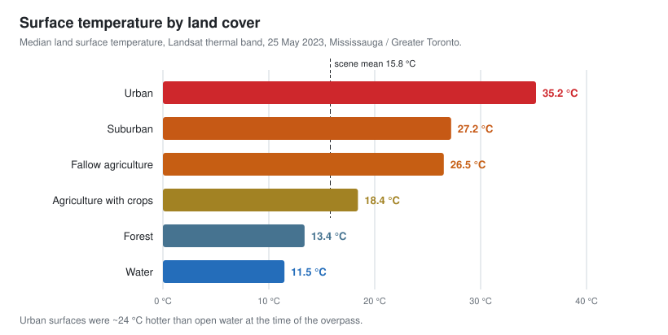

# Urban Heat from Space: Landsat Thermal Analysis of Mississauga


**How much hotter are cities than the land around them, and can a single satellite pass show it?**

This project converts a Landsat thermal-infrared scene of the Greater Toronto Area into land surface temperature (LST) in ArcGIS Pro. It then compares temperatures across six land-cover types, maps the result, and explains the physics behind the patterns: thermal capacity, thermal inertia and sensor resolution.

<p align="center">
  
</p>

## Key findings

- **There is a strong urban heat island.** Urban surfaces (median **35.2 °C**) were about **24 °C hotter** than open water (11.5 °C) and **22 °C hotter** than forest (13.4 °C) during the late-morning overpass.
- **Vegetation cools.** Cropland was about 8 °C cooler than fallow (bare) agricultural land, which is consistent with evapotranspiration and shading.
- **Scene-wide LST** ranged from −12.7 °C to 53.4 °C (mean 15.8 °C, SD 6.9 °C). On the exported map, Lake Ontario is the coolest feature and urban and industrial zones the hottest.

## Data

| | |
|---|---|
| **Scene** | `LC09_L2SP_017030_20230525_20230601_02_T1_ST_B10.TIF` |
| **Sensor** | Landsat 9 TIRS (the `LC09` prefix), Collection 2 Level-2 surface temperature product, band 10 |
| **Path / row** | 017 / 030 (Lake Ontario and the Greater Toronto Area) |
| **Acquired** | 25 May 2023, 15:57 UTC (11:57 AM EDT) |
| **Resolution** | TIRS collects at 100 m and is delivered resampled to 30 m |

## Methods

1. **Digital number to temperature.** I applied the Collection 2 scale factor and offset from the scene metadata, then converted Kelvin to Celsius:

   $$T_{°C} = DN \times 0.00341802 + 149.0 - 273.15$$

2. **Scene statistics.** I computed the minimum, maximum, mean and standard deviation of LST across the raster.
3. **Land-cover sampling.** I took median LST for six representative land-cover types: water, forest, urban, suburban, cropland and fallow agriculture.
4. **Cartography.** I classified LST into five temperature classes (−12–4, 4–12, 12–18, 18–24, 24–53 °C) and exported a finished thermal map.

## Interpretation

- **Thermal inertia.** Water's high heat capacity and thermal inertia keep it cool and stable during the day. Pavement and rooftops heat quickly under morning sun.
- **Diurnal prediction.** In a night-time image 12 hours later, urban surfaces would cool substantially and water would change little. The land–water contrast would shrink or even reverse.
- **Why thermal pixels are coarse.** Emitted long-wave radiation carries far less energy per wavelength interval than reflected visible light. Thermal detectors need larger ground footprints (100 m for TIRS, vs. 30 m for the reflective bands) to collect enough signal.
- **Other thermal sensors.** ASTER (5 TIR bands at 90 m) and MODIS (TIR at 1 km, daily) trade spatial against temporal resolution differently than Landsat.

## Limitations

- A single overpass shows only late-morning conditions, not daily maximums or night-time heat retention.
- Land-cover values are medians of hand-picked sample areas, not a full land-cover classification.
- LST is *surface* temperature (skin temperature of roofs, roads, canopy), which differs from the air temperature people feel.

## Repository structure

```
.
├── report/
│   └── landsat_thermal_analysis.pdf   # Full report with workflow screenshots and the final map
├── figures/
│   └── land_cover_temperature.svg     # README figure
└── scripts/
    └── make_figures.py                # Regenerates the figure (Python stdlib only)
```

## Skills demonstrated

`ArcGIS Pro` · `Raster calculator` · `Landsat Collection 2 radiometric scaling` · `Land surface temperature` · `Urban heat island analysis` · `Thermal remote sensing physics` · `Cartographic design`
